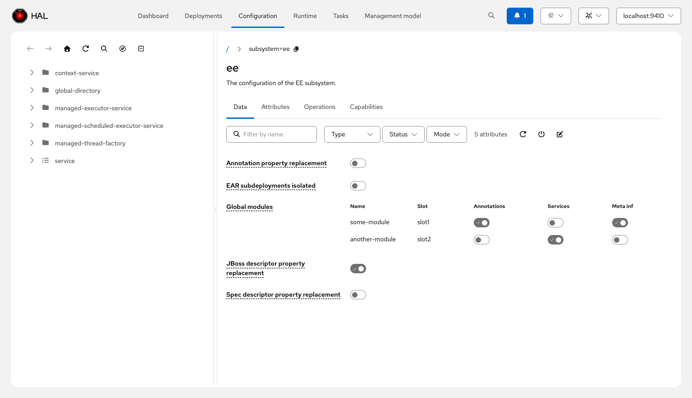
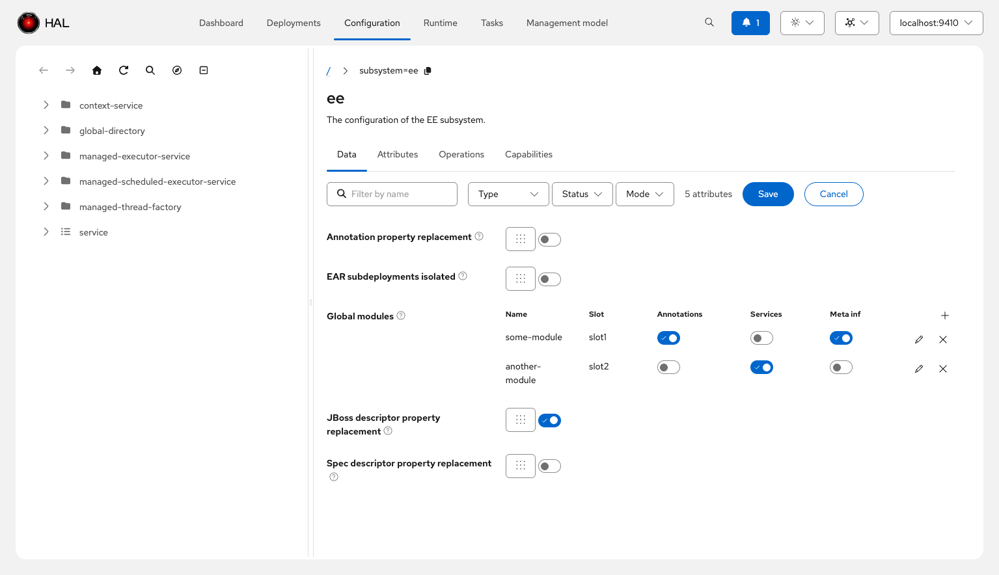

# Resource Management

Managing WildFly resources efficiently requires clear presentation of attributes, their values, constraints, and relationships. The console provides several features to make resource configuration more intuitive and less error-prone.

## Attribute Groups

Attributes are organized using **attribute groups** defined in the resource description metadata. These groups logically cluster related configuration options, making it easier to find and understand the purpose of each attribute. For example, security-related attributes appear together, performance tuning options are grouped, and basic configuration is separated from advanced options.

## Auto-Grouping for Large Resources

When working with resources that define 20 or more attributes and no metadata-defined groups exist, the console applies **automatic alphabetical grouping**. Attributes are split into chunks of roughly equal size along first-letter boundaries — attributes starting with the same letter are never split across groups. Group names use abbreviated attribute labels (e.g., "Allow EJB … – Disable default …"), so you can see at a glance which attributes each section contains.

## Attribute Descriptions

Rather than displaying long descriptions inline, the console shows **attribute descriptions as popovers**. Hovering over an attribute name reveals its full description, including details about its purpose, valid values, and any constraints. This approach keeps the interface clean while ensuring documentation is always accessible.

## Capability References

Attributes that reference capabilities (such as a security domain, SSL context, or data source) display **links to the referenced resources**. Clicking these links navigates to the referenced resource, making it easy to verify or modify related configuration. When multiple references exist, a popup presents all targets.

## Nested Attributes

WildFly's management model supports complex nested attributes. The console handles both **simple nested attributes** (editable structures with a few levels of nesting) and **complex nested attributes** (read-only display of deeply nested structures). This ensures you can view and modify nested configuration without needing to resort to CLI commands.

## Allowed Values

For attributes with constrained value sets (enumerations or predefined options), the console displays the **allowed values** alongside the attribute. This eliminates guesswork and reduces configuration errors by showing exactly what values are valid.

## Expression Syntax Highlighting

WildFly expressions (such as `${jboss.bind.address:127.0.0.1}`) are highlighted with **syntax highlighting** to distinguish literal values from expressions. This visual distinction makes it clear when configuration uses environment variables, system properties, or vault expressions.

## Form-Level Validation

The console auto-detects **cross-field constraints** from the management model metadata — specifically the `requires` and `alternatives` relationships between attributes. When you edit a resource, the form validates these constraints before submission:

- **Requires**: if attribute A requires attribute B, the console ensures B is defined whenever A is set.
- **Alternatives**: if attributes A and B are alternatives, the console prevents setting both at the same time.

These validations run alongside per-attribute type checks, catching configuration errors before they reach the server.

## List of Simple Records

For LIST attributes with a simple-record value type (a list where each entry is a flat object with named fields), the console renders a **compact table view**. Each record appears as a row with columns derived from the value-type metadata.

In edit mode, each row gets add, edit, and remove actions. Clicking edit opens a **modal editor** that presents the record's fields as a form, making it straightforward to work with structured list data without resorting to raw JSON or CLI commands.

