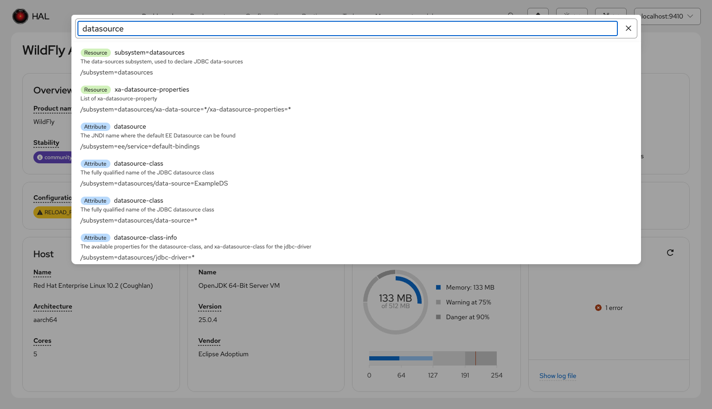
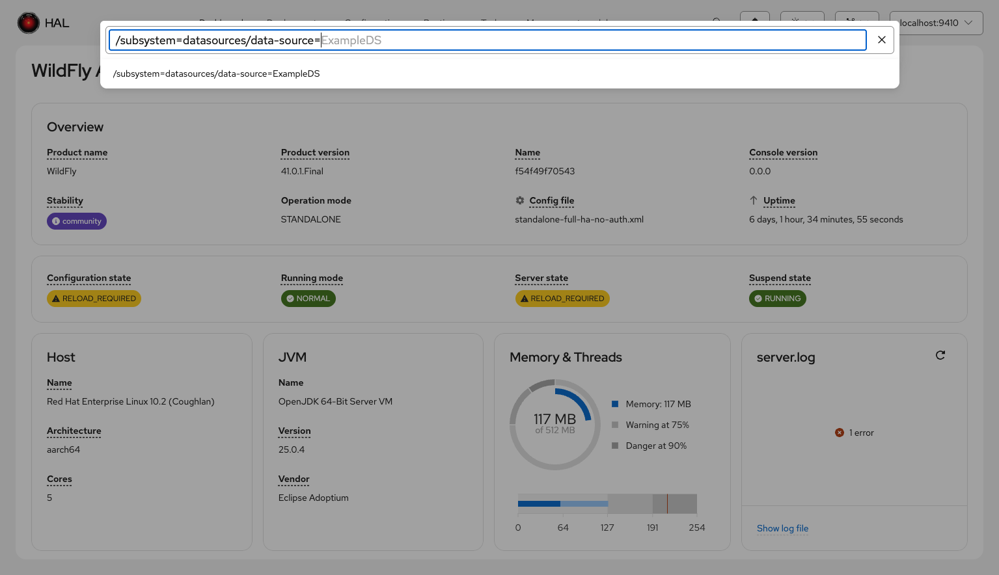
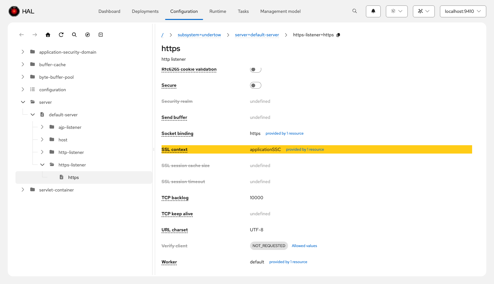

# Universal Search

The console includes a universal search that lets you find resources, attributes, and operations across the entire WildFly management model. Open it with **Cmd+K** (macOS) or **Ctrl+K** (Windows/Linux), or click the search icon in the toolbar.

## Search Modes

Universal search operates in two modes, selected automatically based on what you type.

### Model Graph Search

When you type a plain keyword (not starting with `/`), the search queries the [Model Graph Tools](../model-graph-tools/index.md) service for matching resources, attributes, operations, and capabilities. Results are grouped by type and show descriptions and resource addresses, so you can identify the right match quickly.

Each result is labeled with its type — **Resource**, **Attribute**, **Operation**, or **Capability** — and includes the management model description and the full resource address. Clicking a result navigates directly to the matching resource in the model browser and highlights the target attribute or operation.

This mode is only available when a local MGT container matching your WildFly version is up and running. The [MGT indicator](../model-graph-tools/index.md#console-integration) in the toolbar shows whether a container is detected. Without MGT, only address mode is available.

### Address Navigation

When your input starts with `/`, the search switches to address mode. It provides typeahead completion for each segment of a management model address, resolving wildcards to existing resources on the connected server.

Type a path like `/subsystem=datasources/data-source=` and the console resolves the wildcard segment against the live server, offering the actual resource names (e.g., `ExampleDS`) as completions. Press Enter to navigate directly to the resolved resource.

## Highlight Routing

When you navigate to a resource via universal search, the console scrolls to and highlights the target attribute or operation with a brief yellow flash animation. This makes it easy to locate the exact configuration item you searched for, especially on resources with many attributes.

Highlight routing works with all view item types, including composite items like credential references, file paths, time-unit pairs, maps, and list-of-simple-records.
