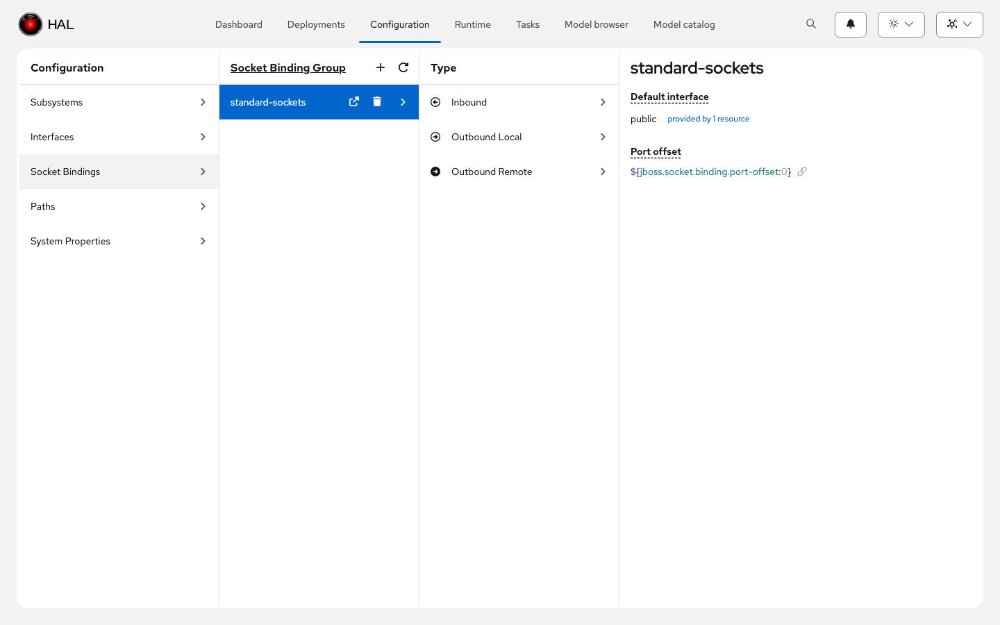

# Finder Navigation

The console uses a **finder** — a multi-column browser — for navigating the configuration, runtime, and deployment sections. Each column represents a level in the management model hierarchy, and selecting an item reveals the next column or a detail preview panel.

## How It Works

The finder presents the management model as a series of columns. The first column shows top-level categories, and each selection opens a new column to the right. The rightmost column either shows another list of children or a detail preview panel for the selected resource. This progressive disclosure keeps the interface uncluttered while making the full hierarchy accessible.

## URL Persistence

The finder URL reflects the current selection path, so bookmarks and browser history work naturally. Sharing a URL with a colleague takes them directly to the same finder state — the same columns, the same selection.

## Navigation Sync

The **finder selection syncs with navigation items** in the sidebar. Clicking a navigation item restores your last selection in that section, so switching between Configuration, Runtime, and Deployments remembers where you left off.

**Browser back and forward buttons** work correctly within the finder. Navigating deeper into the hierarchy pushes state onto the browser history stack, so the standard back button returns to your previous selection rather than leaving the console entirely.
