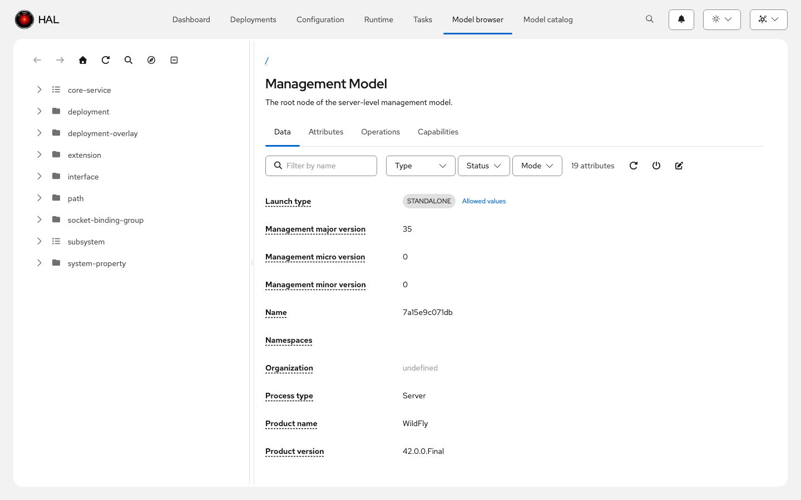
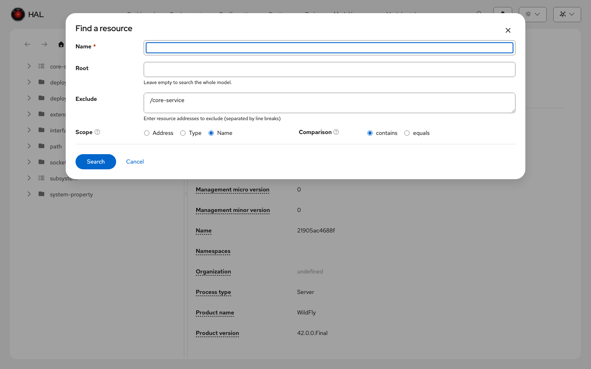
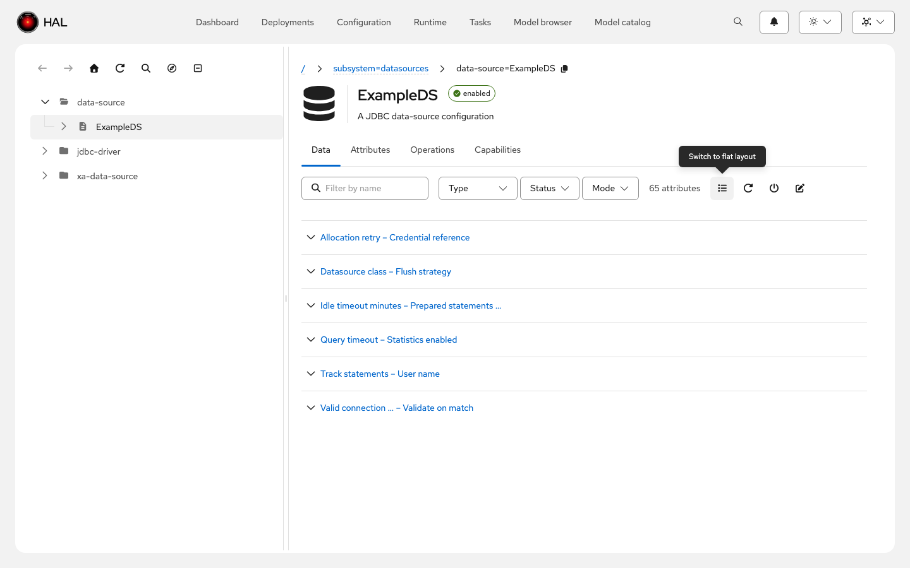
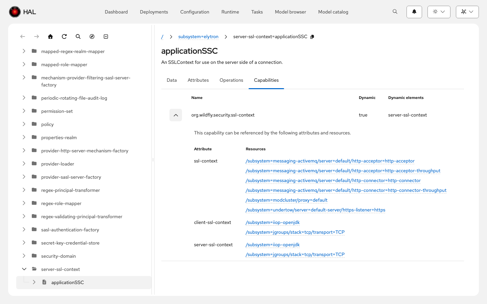

# Model Browser

The model browser is the primary tool for exploring and working with WildFly's management model. It provides a comprehensive view of resources, their attributes, operations, and relationships — and it serves two distinct roles in the console.

## Full and Scoped Mode

In its **full mode**, the model browser lets you explore the entire management model from the root. You can traverse the complete resource hierarchy, inspect any resource at any depth, and jump to arbitrary addresses.

In its **scoped mode**, the model browser drives the configuration pages for subsystems, interfaces, socket bindings, paths, system properties, and other areas of the management model. When you select a subsystem or configuration area in the [finder](./finder.md), the model browser opens rooted at that resource. The same component, the same interaction patterns, but scoped to the relevant subtree. Breadcrumbs, search, and navigation are all confined to the scoped root, so you stay focused on the area you're configuring.

This dual use means there is one consistent tool for both discovery (full mode) and day-to-day configuration (scoped mode).

## Navigation and Search

The model browser features a **resizable tree view** for browsing the resource hierarchy. A **history mechanism** tracks your navigation path with backward and forward buttons, making it easy to retrace your steps.

**Search capabilities** let you find resources by address, type, or name. The **go-to address** feature allows jumping directly to any resource by entering its management model address. **Clickable breadcrumbs** show your current location in the hierarchy and provide quick navigation to parent resources. You can **copy the current address to the clipboard** for use in CLI commands or scripts.

For cross-cutting search across the entire management model, use the [Universal Search](./universal-search.md) (Cmd+K / Ctrl+K).

## Resource Lists and References

Resource list views display **descriptions** directly in the table, giving you context without needing to navigate into each resource. When an attribute references a capability, you can **follow capability references** to navigate to the related resource.

Flat resources without children display the detail panel at full width, keeping the layout clean when no tree navigation is needed.

## Creating Dependent Resources

When configuring a resource that references another resource, the model browser makes it easy to create those dependencies on the fly, streamlining the configuration workflow:

<video controls width="100%">
  <source src="../media/screencasts/add-resources-on-the-fly.mp4" type="video/mp4">
  Your browser does not support the video tag.
</video>

## Data Tab

The Data tab displays the current values of a resource's attributes with powerful filtering and organization:

**Filtering** options let you narrow down attributes by name, status (defined/undefined, required/not required, deprecated/not deprecated), and mode (storage vs. access type).

**Attribute groups** organize attributes into logical sections. When a resource defines attribute groups in its metadata, those groups are used directly. For resources with 20 or more attributes and no metadata-defined groups, **auto-grouping** splits attributes into chunks of roughly equal size along first-letter boundaries, with group names derived from abbreviated attribute labels (e.g., "Allow EJB … – Disable default …"):

**Attribute descriptions** appear as popovers when you hover over an attribute name, providing context without cluttering the interface. Attributes that reference capabilities show **links to the referenced resources**, with support for multiple references displayed in a popup.

The Data tab supports both **simple nested attributes** and **complex nested attributes** in a read-only view, allowing you to inspect deeply structured configuration. **Allowed values** are displayed for attributes with constrained value sets, and **expression syntax** is highlighted for attributes that use WildFly expressions. For resources that need a tailored presentation, the [Resource Shell SPI](../architecture/resource-shell-spi.md) can provide custom tabs, layouts, or editors in place of the generic rendering.

## Attributes Tab

The Attributes tab provides a metadata-focused view of all attributes defined for the resource:

**Filtering** by name, type, status (required/not required, deprecated/not deprecated), and mode (storage/access type) helps you locate specific attributes. Full support for **nested attributes** allows exploration of complex attribute structures.

## Operations Tab

The Operations tab lists all management operations available for the selected resource:

**Filtering** by name, signature (parameters/no parameters, return value/no return value), and deprecation status makes it easy to find the operation you need. A toggle to **omit or show global operations** (remembered as a user setting) reduces clutter by hiding operations inherited from all resources. You can **execute operations** directly from the browser with a form-based interface for providing parameters.

## Capabilities Tab

The Capabilities tab displays all capabilities provided or required by the selected resource. Each capability row is expandable: click the expand button to load the capability's **cross-references** from the [Model Graph Tools](../model-graph-tools/index.md) service.

The expanded view shows which attributes reference this capability, grouped by attribute name. Each resource address is a clickable link that navigates directly to the referencing resource and [highlights](./universal-search.md#highlight-routing) the relevant attribute. Wildcard addresses are resolved against the live server, so only existing resources appear.

This answers the question _"where is this capability used?"_ with one click — useful when investigating dependencies before changing or removing a configuration.