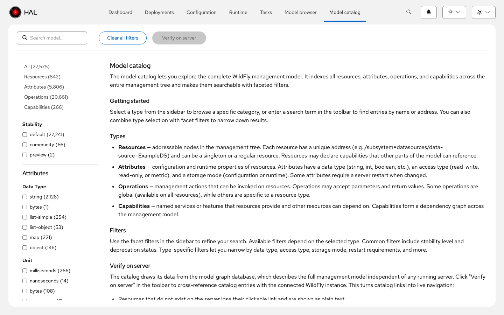
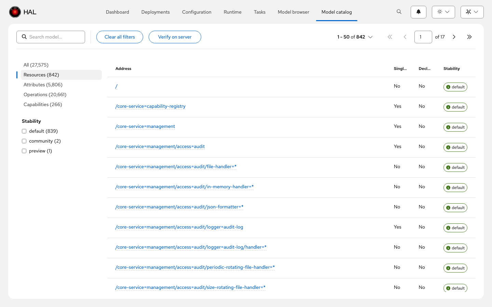
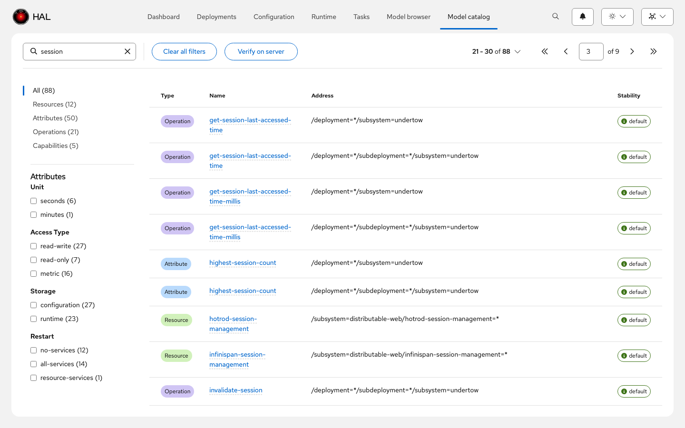
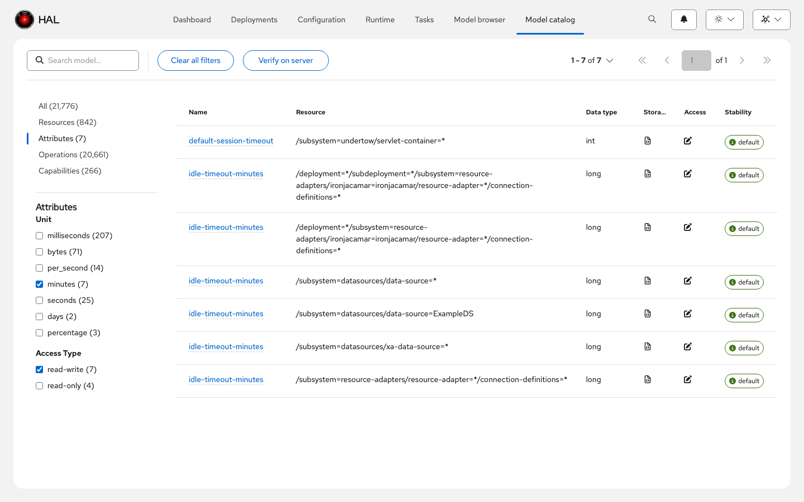

# Model Catalog

The model catalog lets you explore the complete WildFly management model from a single page. It indexes all resources, attributes, operations, and capabilities across the entire management tree and makes them searchable with faceted filters. Open it from the **Model catalog** item in the top navigation.

The model catalog requires a running [Model Graph Tools](../model-graph-tools/index.md) container that matches the connected WildFly version. Without MGT, the catalog page is not available.

## Types

The catalog organizes the management model into four types. Select a type from the sidebar to browse a specific category, or stay on **All** to see results across all types.

### Resources

Addressable nodes in the management tree. Each resource has a unique address (e.g., `/subsystem=datasources/data-source=ExampleDS`) and can be a singleton or a regular resource. Resources may declare capabilities that other parts of the model can reference.

Columns: **Address**, **Singleton**, **Declares capability**, **Stability**

### Attributes

Configuration and runtime properties of resources. Attributes have a data type (string, int, boolean, etc.), an access type (read-write, read-only, or metric), and a storage mode (configuration or runtime). Some attributes require a server restart when changed.

Columns: **Name**, **Resource**, **Data type**, **Storage**, **Access**, **Stability**

### Operations

Management actions that can be invoked on resources. Operations may accept parameters and return values. Some operations are global (available on all resources), while others are specific to a resource type.

Columns: **Name**, **Resource**, **Parameters**, **Return value**, **Stability**

### Capabilities

Named services or features that resources provide and other resources can depend on. Capabilities form a dependency graph across the management model. Each capability lists the resources that declare it.

Columns: **Name**, **Declaring resources**, **Stability**

## Search

Enter a search term in the toolbar to find entries by name or address. The search works across all types — results on the **All** tab include a **Type** column with color-coded labels (Resource, Attribute, Operation, Capability) so you can distinguish results at a glance.

You can combine a search term with a type selection and facet filters to narrow down results further.

## Filters

The sidebar provides facet filters to refine your search. Available filters depend on the selected type. All types share common filters:

- **Stability** — filter by stability level (default, community, preview)
- **Deprecated** — show or hide deprecated items

Type-specific filters offer additional dimensions:

| Type           | Filters                                                                                                                                                               |
| -------------- | --------------------------------------------------------------------------------------------------------------------------------------------------------------------- |
| **Resources**  | Singleton, Declares capability, Defines attribute groups                                                                                                              |
| **Attributes** | Data type, Unit, Access type, Storage, Restart, Required, Nillable, Expressions, Sensitive, Has allowed values, Has alternatives, Has requires, References capability |
| **Operations** | Read-only, Runtime-only, Global, Has parameters, Has return value                                                                                                     |

Selecting a type-specific filter while on the **All** tab implicitly narrows results to that type.

## Verify on Server

The catalog draws its data from the model graph database, which describes the full management model independent of any running server. Click **Verify on server** in the toolbar to cross-reference catalog entries with the connected WildFly instance. This turns catalog links into live navigation:

- **Exists** — the link stays clickable. If the address contained wildcards, the link text updates to the resolved resource name and points directly to it.
- **Does not exist** — the link is replaced with plain text, indicating the resource is not present on the connected server.
- **Multiple matches** — the link stays clickable. Clicking it opens a list that lets you choose which resource to navigate to.

This is useful when the catalog shows the full management model (including resources from subsystems that may not be installed on the connected server) and you want to see which entries actually exist on your server.

::: warning
This operation checks each resource address against the running server, which can involve a large number of management operations. Depending on the size of the result set, it may take a moment to complete.
:::