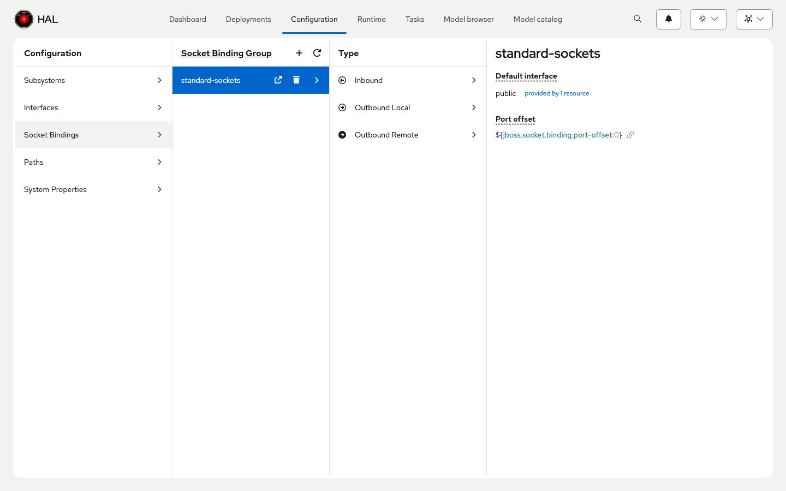

# Features Overview

The HAL management console for WildFly provides a modern, feature-rich interface for managing your WildFly servers and domains. This section highlights the key capabilities that make working with WildFly's management model more efficient and intuitive.

## Universal Search

Press **Cmd+K** (macOS) or **Ctrl+K** (Windows/Linux) to open the [universal search](./universal-search.md). When a local [Model Graph Tools](../model-graph-tools/index.md) container is running, it searches across the entire management model — resources, attributes, operations, and capabilities. Start typing with `/` to switch to address navigation with live typeahead completion. Results link directly to the matching configuration page with the target attribute highlighted.

## Model Catalog

The [model catalog](./model-catalog.md) provides a full-text, faceted search over the entire WildFly management model — resources, attributes, operations, and capabilities — in one page. Filter by stability level, data type, access type, restart requirements, and many more dimensions. Use **Verify on server** to cross-reference catalog entries with the connected WildFly instance and turn static links into live navigation.

## Header Enhancements

The console header provides quick access to essential controls. The **notification badge and drawer** keeps you informed of important events and alerts. The **theme and contrast selector** lets you customize the visual appearance to match your preferences or accessibility needs. The **endpoint selector** makes it easy to switch between different WildFly instances when managing multiple servers. The **MGT indicator** shows whether a [Model Graph Tools](../model-graph-tools/index.md) container is available for the connected WildFly version.

## Stability Level Awareness

WildFly's management model includes stability levels (experimental, preview, community, default) to indicate the maturity of features. The console [highlights these stability levels](./stability.md) across resources, attributes, operations, operation parameters, and capabilities, making it clear when you're working with experimental or preview features that may change in future releases.

## Finder Navigation

The console uses a [finder](./finder.md) — a multi-column browser — for navigating the configuration, runtime, and deployment sections. The finder URL reflects the current selection, so bookmarks and browser history work naturally, and browser back/forward buttons navigate within the finder.

## JavaScript API

For advanced users and automation scenarios, several classes expose a JavaScript API accessible from the browser console. The `MetadataRepository` provides methods to retrieve, lookup, and dump metadata for any resource address. Logging can be controlled programmatically using methods documented in the [Elemento Logger guide](https://hal-console.gitbook.io/elemento/logger#controlling-log-levels-from-javascript).

## Additional Resources

For a comprehensive demonstration of these features in action, watch the [WildFly Community Call presentation from December 2025](https://youtu.be/X43dkm1Zdm4).