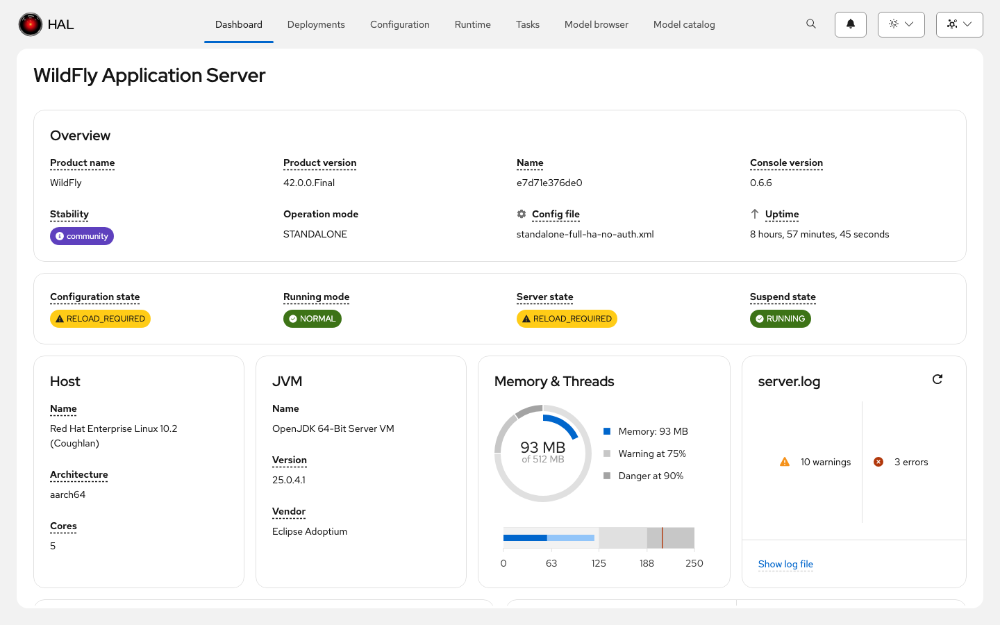

# Features Overview

The HAL management console for WildFly provides a modern, feature-rich interface for managing your WildFly servers and domains. Its UI is fully driven by the management model — every resource, attribute, and operation is rendered automatically from metadata. At the same time, the [Resource Shell SPI](../architecture/resource-shell-spi.md) allows customization where the generic rendering isn't enough, so specialized resources can get tailored tabs, headers, or dialogs without modifying the core console.

## Dashboard

The [dashboard](./dashboard.md) provides an at-a-glance overview of your WildFly server or domain. Card-based layouts present server identity, deployments, memory usage, thread pools, and runtime metrics in a single view. In domain mode, additional cards show host and server status across the entire domain.

## Universal Search

Press **Cmd+K** (macOS) or **Ctrl+K** (Windows/Linux) to open the [universal search](./universal-search.md). When a local [Model Graph Tools](../model-graph-tools/index.md) container is running, it searches across the entire management model — resources, attributes, operations, and capabilities. Start typing with `/` to switch to address navigation with live typeahead completion. Results link directly to the matching configuration page with the target attribute highlighted.

## Tasks

[Tasks](./tasks.md) provide a use-case-centric approach to management operations that span multiple subsystems. Rather than navigating to each resource individually, a task collects the relevant attributes across subsystems into a single workflow — for example, toggling statistics across all resources that support them.

## Finder Navigation

The console uses a [finder](./finder.md) — a multi-column browser — for navigating the configuration, runtime, and deployment sections. The finder URL reflects the current selection, so bookmarks and browser history work naturally, and browser back/forward buttons navigate within the finder.

## Resource Management

[Resource management](./resource-management.md) covers the details of working with individual resources: attribute groups, auto-grouping for large resources, capability reference links, nested attributes, expression highlighting, and form validation. The console adapts its presentation based on the resource's metadata, so the UI stays consistent while accommodating the full variety of the management model.

## Stability Level Awareness

WildFly's management model includes stability levels (experimental, preview, community, default) to indicate the maturity of features. The console [highlights these stability levels](./stability.md) across resources, attributes, operations, operation parameters, and capabilities, making it clear when you're working with experimental or preview features that may change in future releases.

## Model Browser

The [model browser](./model-browser.md) serves two roles. In its **full mode**, it lets you explore the entire management model from the root — a resizable tree view with history navigation, breadcrumbs, and address-based search. In its **scoped mode**, it drives the configuration pages for subsystems, interfaces, socket bindings, paths, system properties, and other areas of the management model. The same component, the same interaction patterns, but rooted at the relevant resource rather than the top of the tree. For each resource, the [attribute pipeline](../architecture/attribute-pipeline.md) automatically transforms metadata into interactive UI controls — forms, view items, and editors — handling everything from simple scalars to complex nested structures.

## Model Catalog

The [model catalog](./model-catalog.md) provides a full-text, faceted search over the entire WildFly management model — resources, attributes, operations, and capabilities — in one page. Filter by stability level, data type, access type, restart requirements, and many more dimensions. Use **Verify on server** to cross-reference catalog entries with the connected WildFly instance and turn static links into live navigation.